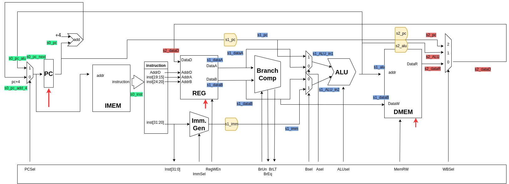

# Welcome to the README of Coupris40!

**[READ THIS](/doc/workFlow.md) BEFORE YOU START WORKING ON THIS PROJECT!!!**

```
The Coupris 40 is a vehicle in Disco Elysium.

An older model of motor carriage than Coupris MotorCorp's Coupris Kineema, the Coupris 40 is a vehicle favoured by working men, including RCM lieutenant Harrier Du Bois and his partner at the 41st Precinct, Jean Vicquemare.

It is fitted with a KR18GU engine, and notable for its skinny tyres in comparison to other MCs such as the Linnea G22. The price is stated to be between ✤ 40,000 to ✤ 45,000.
```


## What is Coupris40?
Coupris 40 is the model of Coupris Kineema -- Kim Kitsuragi's car in Disco Elysium. 
This project aims to build a 3-stage RISC-V processor with SKY-130 PDK. We named it as "Coupris40" because we want an unstable and self-destructive processor, just like Harry Du Bois.

## Pipeline Structure of the Processor


This is an early version of the pipeline structure. We are still working on it.
It by large assembles the pipeline structure of RISC-V processor. 

## Documentation
You can find documentations of this processor in [doc](doc) folder.


## Roadmap
### Checkpoint 1
- [x] The RISC-V opcode compatible ALU has been implemented.

- [x] The testvector generator script written in python has been implemented.

- [x] The early stage of pipeline structure has been drawn.

### Checkpoint 2
- [x] The main skeleton of the pipeline processor has been implemented.

- [x] Control and Status Register (CSR)

- [x] Testbench files, have they passed the test?

- [ ] Updated pipeline structure -- redraw the plot

- [x] Assertions in the verilog modules

### Checkpoint 3
- [ ] TODO

## License
MIT
