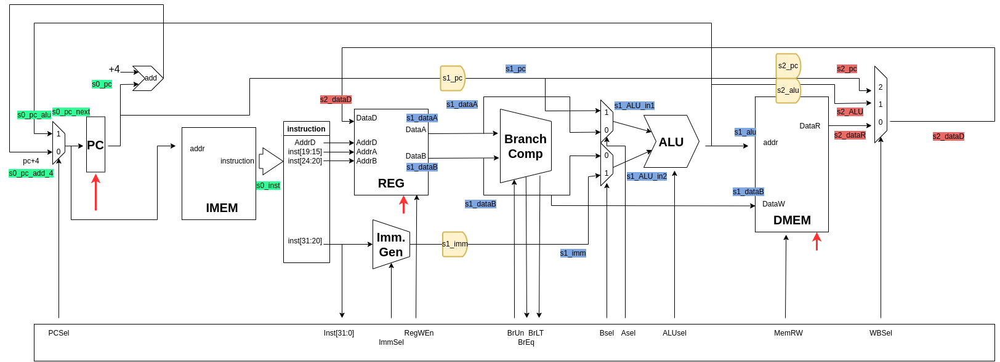

# Notes 24 Oct 2023

## Objective
Checkpoint1: Checkoff by next Monday.

## Todos
-   Common
    -   To discuss where to slice the pipeline diagram.
    -   Draw the 
    -   ALU(Verilog)/ALU testbench design
    -   Python program for ALU test vector generation

## Progress
-   Di
    -   pipeline diagram(halfway through); see [/doc/pipelineDiagram](/doc/pipelineDiagram/pipelineDiagram.png)
    